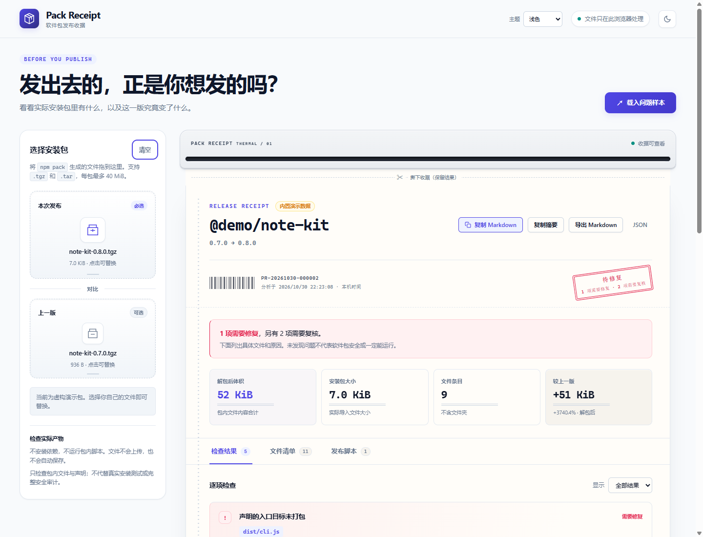
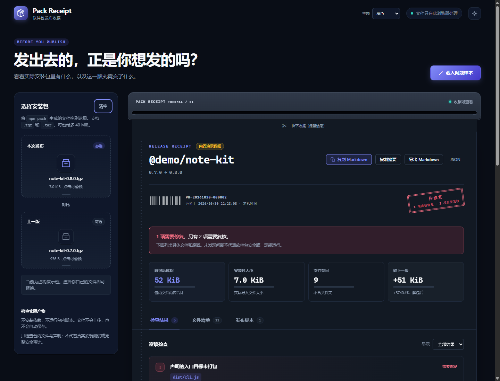

# Pack Receipt

**See what is actually inside your npm tarball before you publish.**

Drop in a `.tgz` to inspect packaged files, missing entry points and unexpected
content. Add the previous release to see what changed, including edits that
keep exactly the same file size. Everything runs locally in your browser.



<details>
<summary>Dark appearance</summary>



</details>

## Open it

**[Open Pack Receipt online](https://nisconder.github.io/pack-receipt/)** — no
installation required. Package archives are still processed only in your browser.

To use it offline:

1. Download the repository ZIP and extract it, or clone it:

   ```sh
   git clone https://github.com/nisconder/pack-receipt.git
   cd pack-receipt
   ```

2. Open **`index.html`** in your browser. On Windows, you can also double-click
   **`打开 Pack Receipt.cmd`**. Keep the project files together; no server,
   Node.js installation or build step is required.
3. Explore the built-in demo, then select or drop your own package into the
   current-release slot. The previous-release slot is optional.

Use a modern Chrome, Edge or Firefox browser with `DecompressionStream`
support for gzip-compressed `.tgz` files. Uncompressed `.tar` files also work.
The interface is currently in Simplified Chinese.

The demo loads automatically and is clearly labeled. Selecting your own file
replaces it; **清空** clears both slots. Without a previous archive, the receipt
shows a single-package inspection and does not label every file as newly added.

## What you can inspect

- **Package contents:** names, file sizes, package metadata and a directory
  size map you can drill into.
- **Entry points:** missing files referenced by `main`, `types`, `bin` and
  `exports`.
- **Release changes:** added, removed and changed files, sortable by path,
  change type, size or size difference.
- **Text differences:** split or unified views with line numbers, line-ending
  markers and explicit notices when previews are truncated.
- **Items worth reviewing:** lifecycle scripts, source maps, `.env` files,
  large fixtures and other potentially accidental package content.
- **A shareable receipt:** copy or download Markdown and JSON, and copy an
  individual file path.

The receipt feeds out of a small thermal-printer interface, then stamps the
actual rule-check result. **撕下收据（保留结果）** visually detaches it while its
file inspector and exports remain usable. **重新打印** replays the presentation
without parsing the archive again. Reduced-motion preferences are respected.
The printed time is the local analysis time, not an npm publication timestamp.

System, light and dark themes are included. Keyboard shortcuts: `/` searches
files, `1`–`3` switch report tabs, arrow/Home/End keys navigate the tab bar,
and Escape closes a preview.

## Try the offline demo

The fictional package **`@demo/note-kit`** changes from `0.7.0` to `0.8.0`.
Both versions are real archives generated locally and read by the same parser
as your selected files.

The comparison includes a same-size JavaScript edit, a larger CSV fixture,
a `.env` example with explicitly fake unusable credentials, a new inert
`preinstall` script, a missing CLI target, valid exports, source maps and
removed files. Nothing in the demo is downloaded or executed.

## Local processing and privacy

Package archives stay in your browser. Pack Receipt does not upload files,
fetch registry packages, install dependencies, run package code or publish
releases. The Windows launcher only opens the local HTML file. Only your
theme preference may be saved locally; package data is not persisted.

When served over HTTP(S), parsing and analysis use a same-origin Web Worker.
Opening `index.html` directly uses a main-thread compatibility path that
yields between processing stages. Both paths apply the same archive limits.

Markdown and JSON exports omit raw archive bytes, `.env` configuration values
and private-key bodies. Common credentials in lifecycle commands are redacted.
Filenames and other metadata can still be private, so review a receipt before
sharing it. Opening a file in the local inspector can display its original text.

## Limits and scope

| Item | Limit |
| --- | --- |
| Each selected archive | 40 MiB |
| Each decompressed tar stream, including headers and padding | 100 MiB |
| Tar headers per archive | 10,000 |
| Text preview per file, per version | 64 KiB |

Archives over these limits are rejected. Text diffs also have computation and
display budgets; the inspector labels approximate or truncated results.

Pack Receipt inspects the archive you supply. It does not reproduce every npm
pack/publish rule, resolve all conditional exports at runtime, audit dependency
trees or verify that an archive matches a registry or source repository.
Findings are evidence to review. A receipt without warnings is not a safety
certificate or a guarantee that the package will run correctly.

## Development

There are **no npm dependencies and no build step**. With Node.js 20 or newer,
start the optional development server:

```sh
npm start
```

Open the URL printed in the terminal. The server listens only on `127.0.0.1`
and chooses an available port; Ctrl+C stops it. **No `npm install` is needed.**

Run the tests:

```sh
npm test
```

The suite covers archive parsing, analysis, real demo integration, text diffs,
file utilities, processing cancellation, theme preferences and printer states.
GitHub Actions runs it on Windows and Ubuntu with Node.js 20, 22 and 24.
Browser checks should also cover file selection, clearing, single-package
inspection, comparison, receipt exports and reduced-motion behavior.

See [FRONTEND-MODULES.md](FRONTEND-MODULES.md) for module contracts and
implementation notes.

## GitHub Pages

The site is deployed to <https://nisconder.github.io/pack-receipt/> by
`.github/workflows/pages.yml`. Every push to `main` runs the tests, packages the
static runtime files and publishes them to GitHub Pages. The workflow can also
be run manually from the Actions tab. Repository **Settings → Pages → Source**
must be set to **GitHub Actions**.

## License

[MIT](LICENSE).
